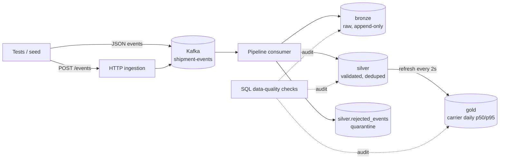

# data-pipeline-quality-lab

[](https://github.com/murillovskfilho/data-pipeline-quality-lab/actions/workflows/pipeline-quality.yml)

A hands-on lab for **testing an event-driven data pipeline end to end**: a Kafka-fed lake with
bronze / silver / gold layers, an automated end-to-end suite, a SQL data-quality suite, and a
**canary** job that injects real defects into the pipeline to prove the checks actually catch them.

The domain is a small multi-tenant shipment-tracking platform. Everything runs locally with one command.

## What this demonstrates

| Skill | Where |
|---|---|
| E2E testing of an **eventually consistent** system, with no fixed sleeps | `src/support/poll.ts`, `tests/e2e/` |
| **Deterministic, seed-driven** test data (same seed = same dataset, everywhere) | `src/seed/generator.ts` |
| Publishing real data through **Kafka and HTTP** | `src/kafka/publisher.ts`, `tests/e2e/http-ingestion.test.ts` |
| Realistic messiness: **replays, out-of-order events, invalid payloads** | `src/seed/chaos.ts`, `src/seed/invalid.ts` |
| **Advanced SQL** checks: percentiles, reconciliation, gaps, duplicates, tenant isolation, freshness | `checks/*.sql` |
| An **independent oracle** for aggregates (percentiles recomputed from the seed, not from the DB) | `src/seed/expectations.ts` |
| **Testing the tests**: fault injection + canary assertions | `scripts/assert-canary.ts` |
| Parallel-safe tests on a shared database (one tenant namespace per test) | `tests/support/ids.ts` |
| CI with a nightly audit, a job summary and report artifacts | `.github/workflows/pipeline-quality.yml` |

## Architecture



* **bronze** keeps every message, including garbage, so nothing is ever lost silently.
* **silver** promotes valid events once (idempotent by `event_id`), keeps the status of the
  *latest event by event time* (late events can't roll a shipment back), and refuses cross-tenant writes.
* **gold** aggregates delivered shipments per day, tenant and carrier, with p50/p95 transit time.

## Quick start

Requirements: Docker and Node.js 22+.

```bash
npm ci
npm run up          # Kafka + Postgres + pipeline, waits until healthy
npm run test:e2e    # 21 end-to-end tests
npm run seed        # deterministic messy dataset (replays, out-of-order, invalid)
npm run dq:report   # runs every SQL check -> reports/dq-report.{md,json}
npm run down        # stop and wipe
```

Postgres is exposed on `localhost:55432` (user/password/db `lab`/`lab`/`lake`) if you want to explore
the layers in DBeaver or psql.

## The test layers

### 1. End-to-end tests (`tests/e2e`)

| Suite | What it proves |
|---|---|
| `kafka-ingestion` | A full lifecycle published to Kafka lands in bronze and silver with correct fields and timestamps |
| `http-ingestion` | The HTTP edge accepts single events and batches (202), rejects bad envelopes (400) before Kafka |
| `idempotency` | Replays are kept in bronze for audit but promoted to silver exactly once |
| `out-of-order` | A late `OUT_FOR_DELIVERY` doesn't roll back a `DELIVERED` shipment; a late `LABEL_CREATED` backfills data |
| `quarantine` | Each validation rule sends its message to quarantine with the exact reason; tenant isolation holds |
| `gold-aggregates` | Gold counts and p50/p95 match an oracle computed independently from the seed |

Each test owns a unique tenant, so suites run in parallel against a shared database without cleanup
and without interfering with each other. Waiting is done by `pollUntil`, which backs off exponentially
and, on timeout, reports the last value it saw, so a failure explains itself.

### 2. Data-quality checks (`checks/*.sql`)

Each check is a plain SQL file that selects the violating rows. Zero rows means healthy. Metadata
lives in header comments, so new checks need no code.

| Check | Severity | Catches |
|---|---|---|
| `bronze_to_silver_completeness` | critical | Messages silently dropped between layers |
| `silver_duplicate_tracking_events` | critical | Broken deduplication |
| `silver_status_matches_latest_event` | critical | Out-of-order events corrupting state |
| `silver_delivery_timestamps` | major | Delivered without timestamp, or delivered before label creation |
| `silver_lifecycle_gaps` | minor | Missing upstream events |
| `silver_orphan_tracking_events` | major | Referential integrity |
| `silver_cross_tenant_events` | critical | Tenant data leaking across accounts |
| `gold_reconciles_with_silver` | critical | Aggregates drifting from their source (race-safe: only compares rows older than the last refresh) |
| `gold_percentiles_sane` | major | Impossible metrics (negative, p50 > p95) |
| `gold_freshness` | major | A stalled or silently disabled aggregation job |

`npm run dq:report` writes a Markdown and JSON report and, in GitHub Actions, adds it to the job
summary. It fails the build on any **critical** violation.

### 3. Canary: who tests the tests?

A green data-quality dashboard only means something if the checks can turn red. The pipeline
supports deliberate defects through the `FAULTS` variable:

| Fault | Injected defect | Must be caught by |
|---|---|---|
| `dup_events` | Dedup key accidentally includes the Kafka offset | `silver_duplicate_tracking_events` |
| `ignore_order` | Last-write-wins instead of latest-event-wins | `silver_status_matches_latest_event` |
| `skip_gold` | The aggregation job silently stops | `gold_reconciles_with_silver`, `gold_freshness` |

The `canary` CI job starts the pipeline with all faults, seeds the same dataset, and
`scripts/assert-canary.ts` fails the build if any fault goes undetected.

> While building this lab, the canary caught a real bug in a check: `gold_freshness` errored
> (`cannot subtract infinite timestamps`) instead of failing when gold had *never* refreshed.
> A broken check reads like a healthy one on a dashboard. That's the reason this job exists.

Run it locally:

```bash
npm run down
FAULTS=dup_events,ignore_order,skip_gold npm run up
FAULTS=dup_events,ignore_order,skip_gold npm run seed
npm run dq:report -- --no-fail
FAULTS=dup_events,ignore_order,skip_gold npm run canary:assert
```

## Project layout

```
checks/              SQL data-quality checks (one file per rule)
db/init/             lake schema: bronze, silver, gold
scripts/             seed, dq-report, assert-canary
src/pipeline/        Kafka consumer, bronze->silver processor, gold refresh, HTTP edge
src/seed/            seeded generator, chaos (replays/out-of-order), invalid cases, gold oracle
src/dq/              check loader and runner
tests/e2e/           end-to-end suites
tests/dq/            the SQL checks as a Jest suite for local feedback
```

## Design decisions

* **Determinism over randomness.** Data comes from a seeded PRNG; only the tenant namespace is
  unique per run. A failure can be reproduced with the same seed.
* **Poll, never sleep.** Fixed sleeps are either slow or flaky. `pollUntil` returns as soon as the
  condition holds and explains itself when it doesn't.
* **Per-shipment ordering.** Messages are keyed by `shipment_id` and the producer allows one
  in-flight request, so retries can't reorder a shipment's events. Ordering across shipments isn't
  needed, and the pipeline still defends against out-of-order delivery.
* **Quarantine, don't drop.** Invalid events are kept in bronze and listed in
  `silver.rejected_events` with a reason, so "missing data" is always explainable.

## License

MIT
